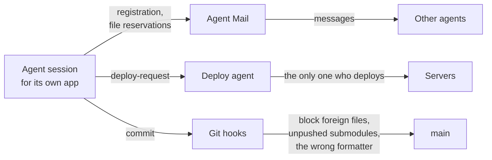

# Letar

The open workshop of [Kami](https://kami.letar.best): libraries, apps and tools built together with a
team of AI agents. Besides the code, you will find the rules and the incident write-ups those agents
work by.

[Forms docs](https://forms.letar.best) · [46 live examples](https://forms-example.letar.best) ·
[Русский](README.md) · MIT License

## Where to start

| You came here to…                                | Read                                                        |
| ------------------------------------------------ | ----------------------------------------------------------- |
| find a form library for React, Vue or Angular    | [Forms from your data schema](#forms-from-your-data-schema) |
| see how dozens of agents maintain one repository | [How AI agents work here](#how-ai-agents-work-here)         |
| meet the author                                  | [kami.letar.best](https://kami.letar.best)                  |

## Forms from your data schema

You describe a model once, in a [ZenStack](https://zenstack.dev) schema. The plugin turns it into a
Zod schema with labels and hints, and `@letar/forms` renders a ready form with validation from it.

```zmodel
model Recipe {
  id       String   @id @default(cuid())
  title    String   @meta("form.title", "Recipe name") @meta("form.placeholder", "Enter a name")
  portions Int      @default(1) @gte(1) @lte(100) @meta("form.title", "Servings")
  tags     String[] @meta("form.title", "Tags") @meta("form.fieldType", "tags")
}
```

```tsx
import { RecipeCreateFormSchema } from '@/generated/form-schemas/Recipe.form'
import { Form } from '@letar/forms'

<Form.FromSchema schema={RecipeCreateFormSchema} initialValue={recipe} onSubmit={save} submitLabel="Save" />
```

<a href="https://forms-example.letar.best/examples/auto-fields">
  
</a>

<sub>A form from a single `Form.FromSchema` line: labels, hints and email validation come from the
schema. [Open the example](https://forms-example.letar.best/examples/auto-fields)</sub>

Need your own layout? Write the fields by hand — validation and labels still come from the schema:

```tsx
<Form schema={RecipeCreateFormSchema} initialValue={recipe} onSubmit={save}>
  <Form.Field.String name="title" />
  <Form.Field.Number name="portions" />
  <Form.Button.Submit>Save</Form.Button.Submit>
</Form>
```

**What's inside:**

- 60+ field types: from text and dates to phone, signature, file upload and input masks for Russian
  documents (INN, SNILS, passport);
- React (Chakra UI v3 or shadcn), Vue and Angular with one shared set of fields;
- form drafts survive a page reload, and there is an offline mode with a submit queue;
- server errors (Prisma, ZenStack, Zod) land on the right field;
- an MCP server that lets an AI agent discover the available fields and directives.

| Package                                                                                    | What it is                                         |
| ------------------------------------------------------------------------------------------ | -------------------------------------------------- |
| [`@letar/forms`](https://www.npmjs.com/package/@letar/forms) ([source](libs/forms/))       | Forms on TanStack Form                             |
| [`@letar/zenstack-form-plugin`](https://www.npmjs.com/package/@letar/zenstack-form-plugin) | ZenStack plugin: form schemas from `schema.zmodel` |
| [`@letar/form-mcp`](https://www.npmjs.com/package/@letar/form-mcp)                         | MCP server for AI agents                           |

> npm currently has version 1.x. The 2.x line (shadcn, Vue, Angular, masks) already lives in
> [libs/forms](libs/forms/) and is being published to npm in stages.

## How AI agents work here

Since May 2026 the repository has gained more than 9,400 commits, about 70 apps and 80 libraries.
Almost all of the code is written by [Claude Code](https://claude.com/claude-code) sessions, often
several at once in the same working directory. A human sets the tasks, makes the decisions and
checks the result.

To keep the agents from getting in each other's way, they work inside a set of rules and barriers:



- **[Agent Mail](https://github.com/Dicklesworthstone/mcp_agent_mail)** — mail between agents. Each
  agent registers under its app's name, reserves files and notifies its neighbours when it changes
  shared code.
- **One deploy agent.** Everyone else is forbidden to deploy and sends it a request instead.
- **Hooks instead of discipline.** Dangerous commands (`git reset --hard`, `git add .`) and commits
  that picked up another app's files are blocked automatically.
- **Every mistake becomes a document.** Found a trap — write it up in [.claude/docs/](.claude/docs/)
  (more than 330 so far) and add a short rule to [.claude/rules/](.claude/rules/). The next session
  reads it before stepping into the same trap.

The most interesting write-ups (in Russian; a browser translator handles them well):

- [Multi-agent git incidents](.claude/docs/git-multi-agent-incidents.md) — how agents lost and
  took each other's work, and what stopped it.
- [Prettier vs dprint](.claude/docs/prettier-dprint-conflict-root-cause.md) — the tenth case of
  "sudden reformatting" and its real cause.
- [bun.lock drift](.claude/docs/bun-lock-drift-unpushed-commits-blocks-all-deploys.md) — how one
  version in one package stopped the deploy of every app.
- [`NODE_ENV` does not tell prod from staging](.claude/docs/node-env-not-production-signal.md) — one
  mistake, three different consequences.
- [Verification pitfalls](.claude/docs/verification-pitfalls.md) — when a green check proves
  nothing.

Where every agent starts — [AGENTS.md](AGENTS.md).

## Open apps

| App                                        | What it is                           | See it                                                       |
| ------------------------------------------ | ------------------------------------ | ------------------------------------------------------------ |
| [form-docs](apps/form-docs/)               | `@letar/forms` documentation         | [forms.letar.best](https://forms.letar.best)                 |
| [form-example](apps/form-example/)         | 46 form examples and PostgreSQL CRUD | [forms-example.letar.best](https://forms-example.letar.best) |
| [pravda](apps/pravda/)                     | Russian legislation, static site     | [pravda.letar.best](https://pravda.letar.best)               |
| [letar-landing](apps/letar-landing/)       | Map of Letar projects                | [letar.best](https://letar.best)                             |
| [animatrona](apps/animatrona/)             | Desktop video app                    | [animatrona.letar.best](https://animatrona.letar.best)       |
| [synth](apps/synth/)                       | In-browser synthesizer               | —                                                            |
| [form-develop-app](apps/form-develop-app/) | Sandbox for form development         | —                                                            |

There are more apps in [apps/](apps/). Some of them are private projects: they are attached as git
submodules, and their folders are empty in the public copy.

## Run it locally

You need Node 24, [Bun](https://bun.sh) and [Nx](https://nx.dev) (`bun add -g nx`).

```bash
git clone https://github.com/kamiletar/letar.git
cd letar
bun install
nx dev form-docs
```

Private submodules are not needed: the open part builds without them. `form-example` also needs a
local PostgreSQL — see [its README](apps/form-example/README.md).

**Want to send a change?** Install the git hooks (`bash scripts/hooks/install.sh`) and format with
`nx run-many -t format --projects=<projects>` — a bare `nx format` runs Prettier instead of dprint.

## Stack

Node 24 · Nx · Next.js 16 (App Router) · React 19 · Chakra UI v3 · PostgreSQL + Prisma + ZenStack ·
TanStack Form · Zod v4 · Vitest · Playwright · oxlint + ESLint · dprint · Bun

## License

[MIT](LICENSE)
