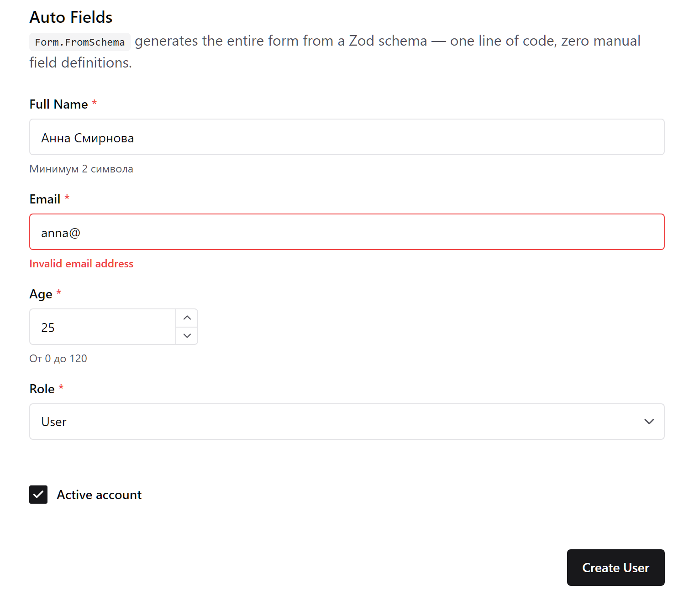
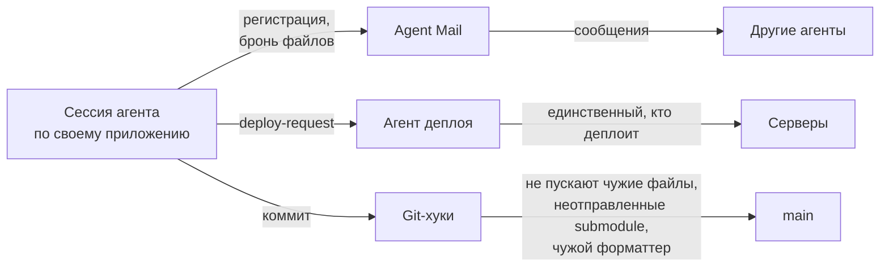

# Letar

Открытая мастерская [Kami](https://kami.letar.best): библиотеки, приложения и инструменты, которые
пишутся вместе с командой ИИ-агентов. Здесь лежит код, а ещё правила и разборы ошибок, по которым
эти агенты работают.

[Документация форм](https://forms.letar.best) · [46 живых примеров](https://forms-example.letar.best) ·
[English](README.en.md) · Лицензия MIT

## С чего начать

| Вы пришли, чтобы…                                  | Читайте                                                       |
| -------------------------------------------------- | ------------------------------------------------------------- |
| найти библиотеку форм для React, Vue или Angular   | [Формы из схемы данных](#формы-из-схемы-данных)               |
| узнать, как один репозиторий ведут десятки агентов | [Как здесь работают ИИ-агенты](#как-здесь-работают-ии-агенты) |
| познакомиться с автором                            | [kami.letar.best](https://kami.letar.best)                    |

## Формы из схемы данных

Вы описываете модель один раз — в схеме [ZenStack](https://zenstack.dev). Плагин делает из неё
Zod-схему с подписями и подсказками, а `@letar/forms` рисует по ней готовую форму с проверкой
ввода.

```zmodel
model Recipe {
  id       String   @id @default(cuid())
  title    String   @meta("form.title", "Название рецепта") @meta("form.placeholder", "Введите название")
  portions Int      @default(1) @gte(1) @lte(100) @meta("form.title", "Количество порций")
  tags     String[] @meta("form.title", "Теги") @meta("form.fieldType", "tags")
}
```

```tsx
import { RecipeCreateFormSchema } from '@/generated/form-schemas/Recipe.form'
import { Form } from '@letar/forms'

<Form.FromSchema schema={RecipeCreateFormSchema} initialValue={recipe} onSubmit={save} submitLabel="Сохранить" />
```

<a href="https://forms-example.letar.best/examples/auto-fields">
  
</a>

<sub>Форма из одной строки `Form.FromSchema`: подписи, подсказки и проверка email взяты из схемы.
[Открыть пример](https://forms-example.letar.best/examples/auto-fields)</sub>

Нужна своя вёрстка — пишете поля руками, а проверка и подписи всё равно берутся из схемы:

```tsx
<Form schema={RecipeCreateFormSchema} initialValue={recipe} onSubmit={save}>
  <Form.Field.String name="title" />
  <Form.Field.Number name="portions" />
  <Form.Button.Submit>Сохранить</Form.Button.Submit>
</Form>
```

**Что внутри:**

- 60+ типов полей: от текста и дат до телефона, подписи, загрузки файлов и масок для ИНН, СНИЛС,
  паспорта;
- React (Chakra UI v3 или shadcn), Vue и Angular с одним набором полей;
- черновик формы переживает перезагрузку страницы, есть офлайн-режим с очередью отправки;
- ошибки сервера (Prisma, ZenStack, Zod) попадают к нужному полю;
- MCP-сервер, через который ИИ-агент узнаёт, какие поля и директивы есть.

| Пакет                                                                                      | Что это                                        |
| ------------------------------------------------------------------------------------------ | ---------------------------------------------- |
| [`@letar/forms`](https://www.npmjs.com/package/@letar/forms) ([исходники](libs/forms/))    | Формы на TanStack Form                         |
| [`@letar/zenstack-form-plugin`](https://www.npmjs.com/package/@letar/zenstack-form-plugin) | Плагин ZenStack: схемы форм из `schema.zmodel` |
| [`@letar/form-mcp`](https://www.npmjs.com/package/@letar/form-mcp)                         | MCP-сервер для ИИ-агентов                      |

> На npm сейчас версия 1.x. Ветка 2.x (shadcn, Vue, Angular, маски) уже в [libs/forms](libs/forms/)
> и выходит на npm по этапам.

## Как здесь работают ИИ-агенты

С мая 2026 года в репозитории больше 9 400 коммитов, около 70 приложений и 80 библиотек. Почти весь
код пишут сессии [Claude Code](https://claude.com/claude-code), часто несколько одновременно и в
одном рабочем каталоге. Человек ставит задачи, принимает решения и проверяет результат.

Чтобы агенты не мешали друг другу, вокруг них выстроены правила и барьеры:



- **[Agent Mail](https://github.com/Dicklesworthstone/mcp_agent_mail)** — почта между агентами. Каждый
  агент регистрируется под именем своего приложения, бронирует файлы и пишет соседям, если меняет
  общий код.
- **Один агент деплоя.** Остальным деплоить запрещено, они отправляют ему заявку.
- **Хуки вместо дисциплины.** Опасные команды (`git reset --hard`, `git add .`) и коммиты, которые
  захватили файлы чужого приложения, блокируются автоматически.
- **Каждая ошибка становится документом.** Нашли ловушку — пишем разбор в
  [.claude/docs/](.claude/docs/) (их уже больше 330), а короткое правило — в
  [.claude/rules/](.claude/rules/). Следующая сессия читает его до того, как наступит на ту же
  ловушку.

Самые интересные разборы:

- [Инциденты многоагентной работы с git](.claude/docs/git-multi-agent-incidents.md) — как агенты
  теряли и забирали чужую работу и что это остановило.
- [Prettier против dprint](.claude/docs/prettier-dprint-conflict-root-cause.md) — десятый случай
  «внезапного форматирования» и его настоящая причина.
- [Рассинхрон bun.lock](.claude/docs/bun-lock-drift-unpushed-commits-blocks-all-deploys.md) — как
  одна версия в одном пакете останавливала деплой всех приложений.
- [`NODE_ENV` не отличает прод от staging](.claude/docs/node-env-not-production-signal.md) — одна
  ошибка, три разных последствия.
- [Ловушки проверки](.claude/docs/verification-pitfalls.md) — когда зелёная проверка ничего не
  доказывает.

С чего начинает каждый агент — [AGENTS.md](AGENTS.md).

## Открытые приложения

| Приложение                                 | Что это                               | Посмотреть                                                   |
| ------------------------------------------ | ------------------------------------- | ------------------------------------------------------------ |
| [form-docs](apps/form-docs/)               | Документация `@letar/forms`           | [forms.letar.best](https://forms.letar.best)                 |
| [form-example](apps/form-example/)         | 46 примеров форм и CRUD на PostgreSQL | [forms-example.letar.best](https://forms-example.letar.best) |
| [pravda](apps/pravda/)                     | Законодательство РФ, статический сайт | [pravda.letar.best](https://pravda.letar.best)               |
| [letar-landing](apps/letar-landing/)       | Карта проектов Letar                  | [letar.best](https://letar.best)                             |
| [animatrona](apps/animatrona/)             | Десктоп-приложение для видео          | [animatrona.letar.best](https://animatrona.letar.best)       |
| [synth](apps/synth/)                       | Синтезатор в браузере                 | —                                                            |
| [form-develop-app](apps/form-develop-app/) | Песочница для разработки форм         | —                                                            |

В [apps/](apps/) есть и другие приложения. Часть из них — приватные проекты: они подключены как
git submodules, и в открытой копии их папки пустые.

## Запустить у себя

Нужны Node 24, [Bun](https://bun.sh) и [Nx](https://nx.dev) (`bun add -g nx`).

```bash
git clone https://github.com/kamiletar/letar.git
cd letar
bun install
nx dev form-docs
```

Приватные submodules не нужны: открытая часть собирается без них. Для `form-example` нужна ещё
локальная PostgreSQL — шаги в [его README](apps/form-example/README.md).

**Если хотите прислать правку:** поставьте git-хуки (`bash scripts/hooks/install.sh`) и
форматируйте через `nx run-many -t format --projects=<проекты>` — голая `nx format` запускает
Prettier вместо dprint.

## Стек

Node 24 · Nx · Next.js 16 (App Router) · React 19 · Chakra UI v3 · PostgreSQL + Prisma + ZenStack ·
TanStack Form · Zod v4 · Vitest · Playwright · oxlint + ESLint · dprint · Bun

## Лицензия

[MIT](LICENSE)
